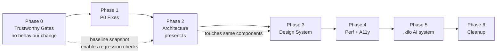

# Architecture Remediation Plan

> Derived from the full repository audit of 2026-08-25.
> Companion documents: `.kilo/plans/1787564533702-portfolio-resume-system.md` (original architecture plan),
> `docs/phase-status.md` (build log — contains stale claims, see T6.2).

---

## 0. How to use this document

**If you are an AI agent starting a fresh session:** read sections 1–4 in full before touching any file.
They contain the verified facts and invariants you would otherwise have to re-derive. Then execute
exactly one phase, in order, verifying after every task.

**Rules for execution:**

1. **Phases are dependency-ordered.** Do not start Phase N+1 until Phase N's exit criteria pass.
   Phase 0 exists specifically so that later phases have a working safety net — skipping it makes
   every subsequent phase unverifiable.
2. **One task = one commit.** Task IDs (`T0.1`, `T2.3`, …) are stable; use them in commit messages,
   e.g. `fix(ci): install pnpm and target main branch (T0.1)`.
3. **Run the validation listed on the task.** Not a substitute for, but in addition to, the full gate
   in §3.
4. **Never mark a task done without quoting real command output.** Several claims in
   `docs/phase-status.md` are false precisely because this was not done (see T6.2).
5. **Do not widen scope.** If a task reveals an unrelated problem, add it to §8 (Deferred) and move on.
6. **Tasks marked `[independent]` can be done in any order within their phase.** Tasks marked
   `[blocks: …]` must precede the listed tasks.

**Status markers:** `[ ]` pending · `[~]` in progress · `[x]` done · `[-]` cancelled/deferred

---

## 1. Verified baseline (do not re-audit — these were measured, not inferred)

Recorded 2026-08-25 against commit `a51bebc`, branch `main`.

### 1.1 Toolchain results

| Command             | Result                                                                                                              |
| ------------------- | ------------------------------------------------------------------------------------------------------------------- |
| `pnpm check`        | 0 errors, 2 hints (`eslint.config.js:6` deprecation; `[slug].astro:17` unused `project`)                            |
| `pnpm test`         | 36 passed, 4 files                                                                                                  |
| `pnpm lint`         | passes — **but silently skips all `.astro` files**: `"File ignored because no matching configuration was supplied"` |
| `pnpm format:check` | **FAILS — 32 files.** No `.astro` file is listed at all (Prettier cannot parse them)                                |
| `pnpm build`        | 8 HTML routes                                                                                                       |

### 1.2 Measured artifact facts

- `resume-brief.pdf` = **2 pages** (`VariantConfig.pdfPages` declares `1`)
- `resume-ats.pdf` = **2 pages** (declares `1`)
- `resume-fullstack.pdf` = 2 pages (declares 2) ✔
- `resume-frontend.pdf` = 2 pages (declares 2) ✔
- `public/downloads/resume-ats.txt` line 2 reads `JORDAN AVERY — STANDARD ATS FORMAT`
- `dist/print/resume/index.html` and `dist/print/resume/fullstack/index.html` have **identical md5**
- `dist/` contains **zero `.js` files** (zero-bundled-JS baseline holds — protect this)
- `dist/index.html` = 71,845 bytes, of which **14,296 bytes is inline JS across 8 blocks**;
  `PaletteSelector`'s script (2,352 B) and `ThemeToggle`'s (696 B) are each emitted **twice**
- `public/redesign.png` = 1,353,187 bytes, referenced by nothing, git-tracked, deployed
- Built CSS contains `@keyframes pulse-dot{0%,to{…}50%{…}}` — the `@media` nested inside it at
  `global.css:177-179` was **dropped by the CSS parser**; `.content-shell:before` has no mobile hide rule
- No `@font-face`, no `.woff2`, no Google Fonts link exists anywhere — `--font-sans: "Inter"` and
  `--font-mono: "JetBrains Mono"` **never load**
- Tailwind utility classes in `src/`: effectively **zero**
- `Astro.throw` does **not** exist in Astro 7 (`AstroGlobal` members: `has, headers, render, response, self, slots`)
- No `wrangler.toml`, no `.env.example`, no `.dev.vars`

### 1.3 Measured contrast (sRGB, WCAG 2.1) — the design budget

| Combination                                                                            | Ratio                     | Verdict      |
| -------------------------------------------------------------------------------------- | ------------------------- | ------------ |
| `#ffffff` on dark-mode amber accent `hsl(33 85% 62%)` — **default theme, primary CTA** | **2.04**                  | FAIL         |
| `#ffffff` on dark emerald / ocean / rose / amethyst accent                             | 1.71 / 2.78 / 3.22 / 3.47 | FAIL (all 5) |
| `#ef4444` (error text) on light `--bg`                                                 | **3.55**                  | FAIL AA      |
| `--text-subtle` `hsl(28 10% 57%)` on light `--bg`                                      | **2.92**                  | FAIL AA      |
| emerald light accent `hsl(160 84% 34%)` as text on `--bg`                              | **3.18**                  | FAIL AA      |
| `.code-string` `hsl(145 48% 62%)` on light `--surface`                                 | **1.94**                  | FAIL         |
| `.code-number` `hsl(29 92% 70%)` on light `--surface`                                  | **1.83**                  | FAIL         |
| `#ffffff` on light amber accent                                                        | 4.85                      | pass         |
| `--text-muted` `hsl(28 12% 40%)` on light `--bg`                                       | 5.31                      | pass         |
| light amber accent as text on `--bg`                                                   | 4.58                      | pass         |

### 1.4 Measured duplication counts

- `.section-header` / `.section-tag` / `.section-title` CSS duplicated verbatim in **5** components:
  `ContactSection`, `ExperienceSection`, `EducationSection`, `ProjectsSection`, `SkillSection`
- `color: #ffffff` / `#fff` on an accent background: **9** declarations
- Hardcoded colours in `pages/print/resume/[...variant].astro`: **49**
- Raw `hsl()` literals in `.astro` files (bypassing tokens): **17**
- Magic `border-radius` literals: **16** (13 in live code, 3 in dead `Welcome.astro`)
- Distinct `max-width` breakpoints: **9** (`30/32/35/36/38/40/42/48/52rem`) + JS `innerWidth > 768`
- Distinct container widths: **4** (`58/66/76/82rem`), 3 hardcoded
- Magic number `2000` (message max length): **5** places
- Token usage: `--radius-sm` 17, `--radius` 8, `--radius-full` 6, `--radius-md` 4, `--radius-lg` 3,
  `--transition-smooth` **0**, `--shadow-color` **0**
- Unused CSS classes: `.print-only`, `.page-break-before-always`, `.animate-fade-in` — **0** uses each

### 1.5 The three renderers (root cause of most defects)

One résumé fact is rendered by three independent code paths:

| Renderer | File                                               | Sorts experience?                         | Formats dates?  |
| -------- | -------------------------------------------------- | ----------------------------------------- | --------------- |
| Web      | `src/components/*.astro` + `src/pages/index.astro` | **yes** (`ExperienceSection.astro:11-14`) | experience only |
| Print    | `src/pages/print/resume/[...variant].astro`        | **no**                                    | experience only |
| Text     | `scripts/generate-txt.ts`                          | **no**                                    | experience only |

Consequence: `education` and `certifications` dates render as raw ISO fragments in **6** places —
`EducationSection.astro:34,71`, `[...variant].astro:235,254`, `generate-txt.ts:90,100`.

---

## 2. Invariants — never violate these

These are load-bearing. Breaking one is a regression even if tests pass.

1. **`src/data/**` imports nothing outside itself.** It is the domain layer. No Astro imports, no
   presentation concerns, no `astro:content`.
2. **`resume.ts` is the single source of truth for résumé facts.** Never hardcode identity, dates,
   or tech lists in a component, layout, page, or `og-image.svg`.
3. **`dist/` must contain zero `.js` files.** Verify after any UI change: `find dist -name "*.js"`.
4. **A résumé fact added to one renderer must be added to all three** (§1.5) or explicitly excluded
   via `VariantConfig`.
5. **The print document does not use theme tokens.** It is a fixed-palette A4 artifact
   (see ADR-0004, T5.4). Do not "fix" it by wiring in `var(--accent)`.
6. **Do not merge the print and web renderers.** This intentionally deviates from the original plan
   (`1787564533702-*.md`, Loop 2: "shared markup components"). Reasoning recorded in ADR-0001 (T5.4).
   Share the _data adapter_, not markup.
7. **No new breakpoint values.** 9 already exist; use the tokens introduced in T3.2.
8. **CSS `@media` may never be nested inside `@keyframes`.** It is silently dropped (§1.2).
9. **Never claim a command passed without quoting its output.**

---

## 3. The verification gate

The definition of "done" for every task. Run in this order; stop at the first failure.

```bash
pnpm check          # 0 errors
pnpm test           # all pass
pnpm lint           # 0 errors
pnpm format:check   # 0 files (only valid AFTER T0.2)
pnpm build:all      # 8 routes + sitemap + txt + 4 PDFs
find dist -name "*.js" | wc -l          # must be 0
node scripts/verify-outputs.ts          # after T1.3
```

Baseline note: `pnpm format:check` fails on 32 files **today**. That is expected until T0.2.
Do not treat it as a regression before then.

---

## 4. Phase overview & dependency graph



Why this order:

- **P0 first** — no gate currently runs in CI (T0.1), `.astro` files are neither linted nor formatted
  (T0.2), and PDF pagination is non-deterministic (T0.5). Refactoring before this is unverifiable.
- **P1 before P2** — the P0-severity defects are small, isolated, and user-facing. Ship them.
- **P2 before P3** — both touch the same 5 section components. Doing design work first means doing
  it twice.
- **P5 late, deliberately** — writing the AI knowledge base now would document the broken state and
  encode the wrong invariants.

---

## Phase 0 — Trustworthy Gates

**Goal:** make failures visible. **No behaviour changes.** Exit criteria: every command in §3 runs
in CI and locally, and `pnpm format:check` reports 0 files.

### [ ] T0.1 — Fix the CI pipeline `[blocks: everything]`

**Problem.** CI has never executed. Three independent breakages in `.github/workflows/ci.yml`:

- `:5` triggers on `branches: [master]` — the branch is `main`
- `:22` runs `pnpm install` with no `pnpm/action-setup` step — `pnpm` is not on the runner
- `:34` runs `pnpm build:all`, which invokes Playwright, with no browser install step

**Change.** Add `pnpm/action-setup@v4` before `setup-node` (with `cache: pnpm`), change the trigger
and the deploy condition to `main`, add `pnpm exec playwright install --with-deps chromium` before
the build step, and add `pnpm format:check` to the gate list. Extend the "Verify critical files"
step to also assert `dist/downloads/resume-fullstack.pdf`, `-frontend`, `-brief`, `-ats`.

**Validation.** Push a branch, confirm the workflow runs and every step reports real output.
`format:check` is expected to fail here — that is T0.2.

**Rollback.** Revert the file; CI returns to being inert.

---

### [ ] T0.2 — Make `.astro` files lintable and formattable `[blocks: T0.3]`

**Problem.** `pnpm lint` passes only because ESLint skips all 12 `.astro` files
(`"File ignored because no matching configuration was supplied"`). `pnpm format:check` fails on 32
files and does not even list `.astro` files because Prettier cannot parse them. Neither
`eslint-plugin-astro` nor `prettier-plugin-astro` is installed. Net effect: ~2,400 lines of UI and
14 KB of inline client JS have **zero static analysis**.

Visible symptoms: broken indentation at `SiteHeader.astro:127`, `ProjectsSection.astro:76`,
`pages/projects/[slug].astro:122`, `styles/global.css:157`.

**Change.**

1. `pnpm add -D eslint-plugin-astro prettier-plugin-astro`
2. Register the Astro flat config in `eslint.config.js` (`...astro.configs.recommended`), keeping the
   existing `ignores`.
3. Add `plugins: ["prettier-plugin-astro"]` and an `overrides` entry for `*.astro` in `.prettierrc.cjs`.
4. Reconcile `.prettierrc.cjs` with reality: it sets `trailingComma: "none"` and `useTabs: false`,
   but the codebase uses trailing commas throughout and `src/data/theme.ts` + all `.astro` files use
   tabs. **Decide once**, then record it in `.kilo/knowledge/conventions.md` (T5.3). Recommended:
   `trailingComma: "all"`, `useTabs: true` — matches the majority of existing code and minimises the
   T0.3 diff.

**Validation.** `pnpm lint` now reports real findings on `.astro` files (fix or explicitly disable
each). `pnpm exec prettier --check "src/**/*.astro"` parses without error.

---

### [ ] T0.3 — One-shot formatting commit `[depends: T0.2]`

**Problem.** 32 files fail `format:check`.

**Change.** Run `pnpm format`. **Commit this alone, with no other change**, so the mechanical diff is
reviewable and never obscures a logic change.

**Validation.** `pnpm format:check` → 0 files. `pnpm check` → still 0 errors. `pnpm test` → 36 pass.
`pnpm build` → still 8 routes. `git diff HEAD~1 --stat` should show only whitespace/quote churn.

---

### [ ] T0.4 — Commit the runtime configuration contract `[independent]` `[blocks: T1.1]`

**Problem.** No `wrangler.toml`, no `.env.example`, no `.dev.vars`. Six environment variables are
required by running code and **none is documented anywhere**. This is the root cause of all three
P0 configuration failures (T1.1).

**Change.** Create `.env.example` and `wrangler.toml` documenting, with the build-time/runtime split
made explicit:

| Variable                    | Scope           | Consumer                 | Effect if missing (today)                |
| --------------------------- | --------------- | ------------------------ | ---------------------------------------- |
| `PUBLIC_TURNSTILE_SITE_KEY` | **build-time**  | `ContactSection.astro:9` | widget not rendered                      |
| `TURNSTILE_SECRET_KEY`      | runtime         | `contact.ts:251`         | **bot protection silently disabled**     |
| `RESEND_API_KEY`            | runtime         | `contact.ts:283`         | **messages silently discarded**          |
| `CONTACT_TO_EMAIL`          | runtime         | `contact.ts:280`         | falls back to `contact@example.com`      |
| `CONTACT_FROM_EMAIL`        | runtime         | `contact.ts:281`         | falls back to `onboarding@resend.dev`    |
| `RATE_LIMIT_KV`             | runtime binding | `contact.ts:198`         | falls back to per-isolate memory limiter |

State explicitly in a comment: **a build without `PUBLIC_TURNSTILE_SITE_KEY` deployed against a
runtime that has `TURNSTILE_SECRET_KEY` set makes every submission fail with
"Bot verification token is missing".**

**Validation.** `git ls-files` shows both files. `.env` stays gitignored (already is).

---

### [ ] T0.5 — Make PDF pagination deterministic `[independent]` `[blocks: T1.3]`

**Problem.** `scripts/generate-pdf.ts:78` prefers a **system** Chrome if found
(`/usr/bin/google-chrome`, `/usr/bin/chromium`, `/usr/bin/chromium-browser`) and only falls back to
Playwright's pinned Chromium. Different Chrome versions paginate differently — which destroys the
one property the `pdfPages` contract (T1.3) depends on.

**Change.** Delete `launchBrowser`'s `systemChrome` lookup; always use Playwright's bundled Chromium.
CI installs it in T0.1. Document the reversal — `docs/phase-status.md:191` records the fallback as an
intentional workaround for restricted browser downloads; it is now a correctness hazard.

While here: `page.goto(…, { waitUntil: 'networkidle' })` at `:126` is the discouraged wait strategy
and does not await `document.fonts.ready`. Change to `waitUntil: 'load'` followed by
`await page.evaluate(() => document.fonts.ready)`. This is a latent PDF-fidelity bug that becomes
real the moment T3.5 introduces web fonts.

**Validation.** `pnpm build:pdf` succeeds. Page counts unchanged from §1.2 (2/2/2/2).

---

### [ ] T0.6 — Record the behaviour baseline `[independent]`

**Problem.** Phases 1–4 change behaviour. Without a recorded starting point there is nothing to diff
against.

**Change.** Create `scripts/snapshot-baseline.ts` (or a documented manual procedure) that records, to
a gitignored `.baseline/` directory: the 8 built route paths, per-variant PDF page counts and byte
sizes, the full `resume-ats.txt`, and the §1.3 contrast matrix. Commit the _script_, not the output.

**Validation.** Running it produces a snapshot matching §1.1–1.3.

---

**Phase 0 exit criteria:** all §3 commands pass locally **and** in CI, including
`pnpm format:check` → 0 files.

---

## Phase 1 — P0 Fixes

**Goal:** eliminate the six critical defects. Each is small and isolated.

### [ ] T1.1 — Fail closed on the contact endpoint `[depends: T0.4]`

**Problem — two distinct P0 bugs in `functions/api/contact.ts`:**

1. **Silent message destruction.** `:283` — `if (resendApiKey) { …send… }`. When the key is absent the
   block is skipped and `:310` returns `{ success: true, message: "Thank you! Your message has been
sent successfully." }`. Nothing is sent, nothing is logged, the visitor is told it worked.
2. **Fail-open bot protection.** `:251` — `if (env.TURNSTILE_SECRET_KEY) { …verify… }`. Absent secret
   ⇒ verification skipped entirely ⇒ unauthenticated mail relay.

**Change.**

- Both secrets become **required**. Missing either ⇒ `503` with a generic client message
  (`"Contact form is temporarily unavailable. Please email me directly."`) and a
  `console.error('[contact] misconfigured: <VAR> not set')` server-side.
- Never leak which variable is missing to the client.
- Strip control characters from `name` before it enters the mail subject at `:289`
  (`name.replace(/[\r\n\u0000-\u001f]/g, ' ')`) — defence-in-depth against header injection.
- Move the rate-limit check (`:202`) to **after** schema validation and the honeypot check, so a
  legitimate visitor's three typos no longer consume their quota.

**Validation.** Add three tests to `functions/api/contact.test.ts`:
`returns 503 when RESEND_API_KEY is absent` · `returns 503 when TURNSTILE_SECRET_KEY is absent` ·
`returns 502 when Resend responds non-ok`. Also fix the existing isolation defect: `:194` and `:239`
assign `global.fetch = vi.fn()` directly, which `vi.restoreAllMocks()` in `beforeEach` does **not**
undo — use `vi.stubGlobal('fetch', …)` with `vi.unstubAllGlobals()`.

**Rollback.** Revert. Note the previous behaviour was worse than an outage: an invisible outage.

---

### [ ] T1.2 — Fix accent-on-white contrast `[independent]`

**Problem.** In the default (dark) theme, the site's primary call-to-action renders white text on the
light amber accent: **2.04:1**. Hard WCAG AA failure on the main action, in all 5 palettes (§1.3).
Nine declarations:

`pages/index.astro:258` (`.btn-resume` — the résumé CTA) · `components/ContactSection.astro:448`
(`.btn-submit`) · `pages/projects/index.astro:200` (`.projects-chip--active`, with `!important`) ·
`components/ProjectCard.astro:311` (`.btn-action.primary:hover`) · `layouts/Layout.astro:107`
(`.skip-link`) · `styles/global.css:128` (`::selection`) · `[...variant].astro:331,336,372`
(print toolbar — screen-only, lower priority but same fix)

Commit `1d240fa` already fixed this pattern in the header only; it was never generalised.

**Change.** Add a semantic token in `styles/global.css`: `--on-accent` — near-black in the dark theme
(where accents are light), white in the light theme (where accents are dark). Add a per-palette
override wherever the light/dark accent luminance is unusual (emerald light accent gives only 3.36:1
against white — see T3.2). Replace all 9 literals with `var(--on-accent)`.

**Validation.** Add `src/styles/contrast.test.ts`: for every palette × theme, assert
`contrast(--on-accent, --accent) >= 4.5`. Re-run the §1.3 matrix; the FAIL rows for
`#ffffff`-on-accent must clear.

---

### [ ] T1.3 — Enforce the PDF page-count contract `[depends: T0.5]`

**Problem.** `VariantConfig.pdfPages: 1 | 2` is consumed **only** as a toolbar label at
`[...variant].astro:46`. No code compares it to reality. Measured: `resume-brief.pdf` and
`resume-ats.pdf` are **2 pages** while declaring **1**. Two of four résumés silently break the
product's core promise.

**Change.**

1. Add `scripts/verify-outputs.ts` exporting `assertPdfPageCount(path, expected)`. Count pages by
   matching `/Type\s*/Page[^s]` occurrences in the PDF bytes (the method used to obtain §1.2) or via
   `page.evaluate` before printing — the byte method is simpler and dependency-free.
2. Call it from `generate-pdf.ts` immediately after each `page.pdf()`; **throw** on mismatch.
3. Add it to the §3 gate and to CI (T0.1).

**Expect `brief` and `ats` to fail immediately. That is the point.** Then make them fit:

- `VARIANTS.brief` — `maxProjects: 3` → try `2`; drop the `Projects` section entirely; tighten
  `.resume-section { margin-top }` under a `data-variant="brief"` attribute on `<html>`.
- `VARIANTS.ats` — `maxProjects: 4` → `2`.
- Do **not** relax `pdfPages` to `2` to make the check pass. The one-page variants exist because
  one-page résumés are requested by recruiters.

**Validation.** `pnpm build:all` succeeds with all four page counts matching their declaration.

---

### [ ] T1.4 — Stop printing config labels as job titles `[independent]`

**Problem.** `variants.ts:89` sets `documentTitle = variant.titleOverride ?? variant.label`, and
`titleOverride` is set on **no** variant. `label` is simultaneously (a) the toolbar switcher text and
(b) the job title printed under the candidate's name.

Verified in the shipped `public/downloads/resume-ats.txt` line 2:

```
JORDAN AVERY — STANDARD ATS FORMAT
```

`resume-brief.pdf` prints _"One-Page Executive Summary"_ as the professional title. Compounded by
`[...variant].astro:55` deriving switcher text via `label.split(' ')[0]`, producing the nav
**"Full-Stack | Senior | One-Page | Standard"**.

**Change.** Split the overloaded field in `src/data/variants.ts`:

```ts
export interface VariantConfig {
	id: ResumeVariant;
	/** Human label for the variant itself, e.g. "Standard ATS Format". UI only. */
	label: string;
	/** Compact switcher text, e.g. "ATS". Never derived from `label`. */
	shortLabel: string;
	/** The professional title printed on the document. Never a config label. */
	jobTitle: string;
	pdfPages: 1 | 2;
	summaryOverride: "short" | "full";
	featuredSkillsFirst: string[];
	maxProjects: number;
	excludedSections?: "certifications"[];
}
```

Suggested values — `fullstack`: `jobTitle: 'Full-Stack Software Engineer'`, `shortLabel: 'Full-Stack'` ·
`frontend`: `'Senior Frontend / UI Engineer'`, `'Frontend'` · `brief`: `'Full-Stack Software Engineer'`,
`'1-Page'` · `ats`: `'Full-Stack Software Engineer'`, `'ATS'`.

Delete `titleOverride` (dead). Have `applyVariant` return `documentTitle = variant.jobTitle`. Replace
`label.split(' ')[0]` with `VARIANTS[vKey].shortLabel`.

**Validation.** Extend `variants.test.ts`: assert every variant's `jobTitle` is a plausible job title
and that `documentTitle` never equals `label` for `ats`/`brief`. Rebuild; grep
`public/downloads/resume-ats.txt` for `STANDARD ATS FORMAT` — must be absent.

---

### [ ] T1.5 — Replace the ineffective rate limiter `[independent]`

**Problem.** `functions/api/contact.ts:62-78` — `createKvRateLimiter` does read → compare → write on
Cloudflare KV, which is eventually consistent (~60 s propagation). Concurrent requests all read `0`
and all pass. The default when no KV is bound is `memoryRateLimiter` (`:40`), which is per-isolate and
therefore near-useless in production. Additionally `expirationTtl` is re-applied on every write, so a
sustained sender is blocked permanently while a burst attacker is unaffected — inverted from intent.

**Change.** Preferred: configure **Cloudflare Rate Limiting rules** on the `/api/contact` route in
`wrangler.toml` (T0.4) and delete both limiters. If application-level limiting must stay, use a
**Durable Object** for atomic counting. Do not attempt to fix the KV counter — the race is inherent.

Also: `clientIp` falls back to `'127.0.0.1'` (`:196`), collapsing all unknown clients into one bucket
— a self-DoS. Prefer rejecting when no `cf-connecting-ip` is present.

**Validation.** Existing rate-limit tests must be rewritten or removed with the code they cover. Do
not leave tests asserting behaviour that no longer exists.

---

### [ ] T1.6 — Security header corrections `[independent]`

**Problem.** In `public/_headers`:

- `:21-23` — `/downloads/*` is served `Cache-Control: public, max-age=31536000, immutable` on
  **mutable, non-hashed URLs**. Regenerated résumés will not reach anyone for up to a year.
- No `Strict-Transport-Security`.
- `:6` — CSP requires `script-src 'unsafe-inline'`, partly forced by `onclick="window.print()"` at
  `[...variant].astro:72`. The theme bootstrap genuinely needs inline execution (FOUC prevention);
  the `onclick` does not.

**Change.** `/downloads/*` → `public, max-age=3600, must-revalidate` (or emit content-hashed
filenames and keep `immutable`). Add
`Strict-Transport-Security: max-age=31536000; includeSubDomains`. Replace the `onclick` with a
`data-print` attribute wired from the existing inline script block, then record in
`.kilo/knowledge/edge-and-secrets.md` (T5.3) that `unsafe-inline` remains **only** for the theme
bootstrap, and what would be needed to drop it.

**Validation.** `curl -I` against a preview deployment, or inspect `dist/_headers`. Confirm the print
button still works and no console CSP violation appears.

---

**Phase 1 exit criteria:** §3 gate passes including `verify-outputs.ts`; all four PDFs match their
declared page counts; the contrast test passes; the contact endpoint has no fail-open branch.

---

## Phase 2 — Architecture

**Goal:** introduce the missing presentation-adapter layer. This is the highest-leverage phase — it
eliminates four defect classes at once and makes them non-recurring.

Target architecture (the layer in **bold** does not exist today):

```
Canonical data (src/data/*.ts)
        ↓  Zod parse at module load
Domain model (inferred types)
        ↓  applyVariant()
Variant resume
        ↓  ► PRESENTATION ADAPTER (src/domain/present.ts) ◄
Display-ready strings
        ↓
Web renderer | Print renderer | Text renderer
        ↓
HTML · 4 PDFs · ATS text
```

Do **not** add a hand-written domain-model layer separate from the Zod-inferred types. The Zod types
_are_ the domain model; duplicating them would be ceremony.

### [ ] T2.1 — Create `src/domain/present.ts` `[blocks: T2.2, T2.3]`

**Problem.** Every field-to-string decision is made independently in three renderers (§1.5). This
produced six raw-date bugs and a latent ordering divergence.

**Change.** New file, pure functions, no Astro imports, no I/O:

```ts
import type { EducationItem, ExperienceItem, Certification, Project, SkillCategory } from "../data/schema.ts";

/** "Jan 2024 – Present" / "Jun 2021 – Dec 2023". The ONLY place a date becomes text. */
export function dateRange(start: string, end?: string): string;

/** Single month-year. Throws on malformed input rather than yielding "Invalid Date". */
export function monthYear(value: string): string;

/** tier=primary first, then startDate descending. Used by ALL renderers. */
export function orderedExperience(items: ExperienceItem[]): ExperienceItem[];

/** tier rank (flagship>notable>experiment), then title. Replaces index truncation. */
export function orderedProjects(items: Project[]): Project[];

/** "TypeScript, React, Node.js" — one join policy, one separator. */
export function skillLine(category: SkillCategory): string;

/** Education/certification display fields, dates already formatted. */
export function educationLine(item: EducationItem): { heading: string; dates: string; honors?: string };
export function certificationLine(item: Certification): { heading: string; date: string };
```

Move `src/lib/formatDate.ts` in here and delete it — it has no validation and no test, yet six
defects live in its blast radius. `monthYear` must reject malformed input; today
`new Date(NaN, …)` silently yields `"Invalid Date"` because `startDate` is an unconstrained
`z.string()`.

Standardise on **one** dash character. Currently: `—` (web, `ExperienceSection.astro:48`), `–`
(print, `:164`), `–` (text, `:55`). Pick the en dash `–` for date ranges.

**Validation.** New `src/domain/present.test.ts` — the highest-value unit target in the repo. Cover
open-ended ranges, malformed input, single-month spans, ordering stability, and empty arrays.

---

### [ ] T2.2 — Migrate all three renderers onto `present.ts` `[depends: T2.1]` `[blocks: T2.3]`

**Change, file by file:**

| File                                    | Edit                                                                                                                              |
| --------------------------------------- | --------------------------------------------------------------------------------------------------------------------------------- |
| `components/ExperienceSection.astro`    | **delete** the local sort at `:11-14`; call `orderedExperience(items)`; use `dateRange()` at `:48`                                |
| `components/EducationSection.astro`     | `:34` and `:71` — replace raw `{item.startDate} — {item.endDate}` and `{cert.date}` with `educationLine`/`certificationLine`      |
| `pages/print/resume/[...variant].astro` | `:164` `dateRange()`; **`:235` and `:254` raw dates → adapter**; `:142` `skillLine()`; wrap `experience` in `orderedExperience()` |
| `scripts/generate-txt.ts`               | `:55` `dateRange()`; **`:90` and `:100` raw dates → adapter**; `:47` `skillLine()`; wrap in `orderedExperience()`                 |
| `components/ProjectsSection.astro`      | replace the local `orderRank` sort at `:11-18` with `orderedProjects()`                                                           |

**Validation.** All six raw-date sites are gone: `grep -rn "startDate}\|cert.date}\|endDate}" src scripts`
returns only adapter calls. Rebuild and read `public/downloads/resume-ats.txt` — the EDUCATION block
must read `Jun 2015 – Jun 2019`, not `2015-09 – 2019-06`.

---

### [ ] T2.3 — Add the cross-renderer consistency test `[depends: T2.2]`

**Problem.** Nothing prevents T2.1/T2.2's defect classes from recurring. This test is what makes the
fix permanent.

**Change.** New `scripts/verify-outputs.ts` assertions (or a Vitest suite that runs post-build):

1. Every company in `resumeData.experience` appears in `dist/index.html`, in each of the 4 PDFs
   (extracted text), and in `resume-ats.txt`.
2. Experience **order** is identical across the web HTML, each PDF, and the ATS text.
3. **No raw ISO date** appears in any output: `/\b\d{4}-\d{2}\b/` must not match `resume-ats.txt` or
   any PDF text.
4. `resume-ats.txt` is pure ASCII (`/^[\x09\x0a\x20-\x7e]*$/`) — see T4.7.
5. Every `project.slug` with `hasCaseStudy: true` has a matching case study; every case-study
   `projectSlug` matches a real project; every URL in `sitemap.xml` corresponds to a built route.

Item 5 closes three latent 404 generators: `generate-sitemap.ts:19-31` re-reads the case-studies
directory with `fs.readdirSync` **and** separately adds every `hasCaseStudy` project — two
independent route sources that can disagree with the actual content collection.

**Validation.** Deliberately break one thing (e.g. set `hasCaseStudy: true` on `design-system`) and
confirm the test fails. Revert.

---

### [ ] T2.4 — Fix variant transformation semantics `[independent]`

**Problem, in `src/data/variants.ts`:**

- `:79` — `projects: data.projects.filter((_, index) => index < variant.maxProjects)` truncates by
  **array position**, ignoring `tier` and `featured`. The `flagship`/`notable`/`experiment` taxonomy
  exists precisely to rank, and is ignored. Reordering `projects.ts` silently changes every résumé.
- `:66-68` — `applySummaryOverride` sets `full = short`, **destroying** the long summary. Downstream
  code can no longer reach the real `summary.full`. The original plan (Loop 2) states variants may
  "only filter or reorder, never mutate".
- `:83` — `result.certifications = undefined` sets the key to `undefined` rather than omitting it.

**Change.** Truncate via `orderedProjects()` (T2.1) before slicing. Replace the summary mutation with
a **selection**: add `activeSummary: string` to `VariantResume` and leave `summary` untouched; update
the three renderers to read `activeSummary`. Use object omission for excluded sections.

**Validation.** Update `variants.test.ts:48-58` (currently asserts `brief.summary.full === brief.summary.short`
— that assertion encodes the bug). Add: `applyVariant` never mutates `summary`; `brief` projects are
the highest-tier ones, not the first three.

---

### [ ] T2.5 — De-duplicate case-study content `[independent]`

**Problem.** `src/content/case-studies/async-threat-platform.md` frontmatter duplicates canonical
project data **and has already diverged**:

| Field | `projects.ts:13` (canonical)                       | `.md:7-13` (duplicate)                                                |
| ----- | -------------------------------------------------- | --------------------------------------------------------------------- |
| tech  | `Astro, Cloudflare, TypeScript, PostgreSQL, React` | `Astro, Cloudflare Workers, React, TypeScript, PostgreSQL, WebSocket` |

`role` and `impactMetrics` are also duplicated. Meanwhile `pages/projects/[slug].astro:17` computes
`project` from canonical data and **never uses it** (confirmed by `pnpm check`: _"'project' is
declared but its value is never read"_), rendering `data.techStack` from frontmatter instead.

Separately, `content.config.ts:3` imports `astro/zod` (**Zod 3**) while the rest of the project uses
`zod` (**Zod 4**) — two validation runtimes.

**Change.** Reduce the frontmatter schema to case-study-specific fields only: `title`, `projectSlug`,
`duration`, `summary`. Delete `role`, `techStack`, `impactMetrics`. Have `[slug].astro` read those
from the canonical project (the variable it already computes). Add a `superRefine` — or rely on the
T2.3 integrity test — to reject a `projectSlug` with no matching project.

Note `content.config.ts:7` globs `**/*.{md,mdx}` but `@astrojs/mdx` is **not installed**; an `.mdx`
file would fail. Either install the integration or narrow the pattern to `*.md`. (`docs/phase-status.md:144`
claims case studies are "rendered as MDX" — false; see T6.2.)

**Validation.** `pnpm check` reports 1 hint fewer. `/projects/async-threat-platform` renders the
canonical tech list. T2.3 item 5 passes.

---

### [ ] T2.6 — Break the build-artifact cycle `[independent]`

**Problem.** `public/downloads/` is **both** an output of `generate-pdf.ts`/`generate-txt.ts` **and**
an input to `astro build` (which copies `public/` → `dist/`). If PDF generation fails partway, `dist/`
already contains stale copies from the copy step. `generate-sitemap.ts:71-74` has the same shape:
it writes `sitemap.xml`/`robots.txt` into `public/` and mirrors them to `dist/` — and both generated
files are **git-tracked**, containing `https://example.com`.

**Change.** Generate straight into `dist/` only; delete the `public/` write and the mirror helpers.
`git rm --cached public/sitemap.xml public/robots.txt` and add both to `.gitignore`
(`public/downloads/` is already ignored). Update `_headers` if paths change.

**Validation.** `rm -rf dist public/downloads && pnpm build:all` produces a complete `dist/`.
`git status` is clean after a build.

---

### [ ] T2.7 — Remove structural dead weight `[independent]`

| Item                          | Location                                                                                                               | Note                                                                                                                                    |
| ----------------------------- | ---------------------------------------------------------------------------------------------------------------------- | --------------------------------------------------------------------------------------------------------------------------------------- |
| Duplicate print route         | `[...variant].astro:12` emits `/print/resume` **and** `:13-16` emits `/print/resume/fullstack` — byte-identical output | Keep one canonical URL; redirect or drop the other. Update `index.astro:72`, `SiteHeader.astro:14`, `generate-pdf.ts:121`               |
| `Astro.throw`                 | `pages/projects/[slug].astro:13`                                                                                       | **Does not exist in Astro 7.** Unreachable today (`getStaticPaths` guarantees the entry) — delete the line, or return a real `Response` |
| `Welcome.astro` (210 lines)   | `src/components/`                                                                                                      | Astro starter template, referenced by nothing                                                                                           |
| `astro.svg`, `background.svg` | `src/assets/`                                                                                                          | Only used by `Welcome.astro`                                                                                                            |
| `redesign.png` (1.35 MB)      | `public/`                                                                                                              | Orphan, git-tracked, deployed — 71 % of `dist/`                                                                                         |
| Unused `project` var          | `[slug].astro:17`                                                                                                      | Resolved by T2.5                                                                                                                        |

**Validation.** `pnpm check` → 0 errors, 1 hint. `pnpm build` → 7 routes (one fewer). `du -sh dist`
drops by ~1.35 MB.

---

**Phase 2 exit criteria:** §3 gate passes; the cross-renderer consistency test passes; no raw ISO
date appears in any output; `grep -rn "formatMonthYear" src scripts` returns nothing (replaced by the
adapter).

---

## Phase 3 — Design System

**Goal:** one coherent token layer. Sequenced after Phase 2 because both phases edit the same five
section components.

### [x] T3.1 — Fix the invalid CSS `[independent]` — do this first, it is one line

**Problem.** `src/styles/global.css:177-179` nests an `@media` block **inside** `@keyframes pulse-dot`:

```css
@keyframes pulse-dot {
  0%, 100% { … }
  @media (max-width: 48rem) {          /* ← invalid */
    .content-shell::before { display: none; }
  }
  50% { … }
}
```

Verified in the built CSS: the `@media` was **silently dropped**. Consequence: the decorative vertical
rule `.content-shell::before` is **never hidden on mobile**, though clearly intended to be.

**Change.** Move the `@media` block to top level.

**Validation.**
`grep -c "content-shell:before" dist/_astro/*.css` and confirm a `@media` block now contains it.
Check a mobile viewport.

---

### [x] T3.2 — Establish the real token layer `[blocks: T3.3]`

**Problem.**

- **Palette values are duplicated verbatim** between `src/data/theme.ts:33-57` (TypeScript + Zod) and
  `src/styles/global.css:77-84` (CSS custom properties). All 5 palettes × 2 modes × 5 tokens, hand-copied,
  with **no test guarding parity**. `theme.ts` is used only for `paletteIds`, swatch rendering, and
  validation — the CSS is what actually themes the site.
- `amber` (the default) has **no** `html[data-palette="amber"]` rule; it relies on `:root` defaults.
  So `themeConfig.defaultPalette` is not honoured before the inline script runs, and changing it in
  `theme.ts` would not change the no-JS rendering.
- **9 breakpoints, 4 container widths, 0 tokens.** `SiteHeader.astro:135` uses `innerWidth > 768`
  while the CSS uses `48rem` — these desync when the user changes root font size, which is an
  accessibility setting.
- **16 magic `border-radius` literals.** `--radius: 12px` is unsemantic inside an `sm/md/lg` scale, and
  6/9/12/14 px is imperceptibly graded. Usage: `--radius-sm` 17, `--radius` 8, `--radius-md` 4, `--radius-lg` 3.
- `--transition-smooth` and `--shadow-color`: **0 uses**.
- No `--danger` token; `#ef4444` is hardcoded at `ContactSection.astro:384,423` at **3.55:1** (AA fail).
- `--text-subtle` is **2.92:1** — used for placeholders and `.footer-meta`.
- emerald light accent is **3.18:1** as text (AA fail).

**Change.**

1. Generate the `global.css` palette block from `theme.ts` at build time, **or** add
   `src/data/theme.test.ts` assertions that parse `global.css` and assert every palette token matches
   `theme.ts` exactly. The test is cheaper and sufficient. Add an explicit
   `html[data-palette="amber"]` rule so all five palettes are expressed symmetrically.
2. Add `--danger` (AA-compliant on both `--bg` and `--surface`), `--on-accent` (from T1.2), and
   breakpoint tokens. Since CSS custom properties cannot be used in media queries, define the
   breakpoint scale as a documented constant list in `.kilo/knowledge/design-system.md` and collapse
   the 9 values to **3–4** (e.g. `35rem`, `48rem`, `64rem`).
3. Darken `--text-subtle` to reach 4.5:1, or restrict it by policy to non-text decoration only.
4. Darken the emerald light accent.
5. Rationalise the radius scale: keep `sm`/`md`/`lg`/`full`, migrate `--radius`'s 8 uses, delete it.
6. Delete `--transition-smooth` and `--shadow-color`.

**Validation.** Extend the T1.2 contrast test to the full token × theme × palette matrix. Add a
`tokens.test.ts` asserting no raw `hsl(`/`#hex` in `src/**/*.astro` outside the print page, and no
`border-radius:` numeric literal. Run the palette-parity test.

---

### [x] T3.3 — Extract `SectionHeader.astro` `[depends: T3.2]`

**Problem.** `.section-header`, `.section-tag`, `.section-title` are duplicated verbatim in **5**
components (`ContactSection:294-315`, `ExperienceSection:91-112`, `EducationSection:91-112`,
`SkillSection:56-77`, `ProjectsSection:60-81` — the last nested inside `.projects-head`, giving it
different specificity). `global.css:152-155` then fights all five with
`!important` (`font-size: .72rem !important; letter-spacing: .14em !important`).

Related dead weight from an abandoned feature (commits `790c59a` then `5b63ede`): all five
components carry a `data-section="0N"` attribute, and `global.css:148-150` contains
`.section-header::before { display: none; }` — the rule that killed the numbered sections.

**Change.** New `src/components/SectionHeader.astro` taking `tag`, `title`, `id`. Replace all five.
Delete the `!important` overrides from `global.css` and fold the intended values into the component.
Remove the 5 `data-section` attributes and the dead `::before` rule.

**Validation.** `grep -rc "\.section-tag {" src/components` → 1 file. `grep -rn "data-section" src` →
empty. Visual check of all five sections in both themes.

---

### [x] T3.4 — Remove self-overriding CSS `[independent]`

**Problem.** Six components declare a property, then override it later in the _same_ stylesheet —
twice using `!important` against themselves:

| File                      | Lines                 | Issue                                                                      |
| ------------------------- | --------------------- | -------------------------------------------------------------------------- |
| `ExperienceSection.astro` | `194-200` then `243`  | `.experience-role` font-size redeclared with `!important`                  |
| `ProjectCard.astro`       | `179-183` then `212`  | `.project-card-subtitle` redeclared with `!important`                      |
| `ProjectCard.astro`       | `116`, `123`          | `background` declared twice                                                |
| `ProjectCard.astro`       | `216`, `218`          | `line-height` declared twice                                               |
| `ContactSection.astro`    | `337,339` / `341,343` | `background` and `border-radius` each twice; `--radius` then `--radius-lg` |
| `ExperienceSection.astro` | `172`, `176`          | `background` twice                                                         |
| `SiteHeader.astro`        | `355`, `358`          | `.mobile-nav-link` font-size twice                                         |
| `ThemeToggle.astro`       | `90-92`, `98-100`     | identical duplicate rule                                                   |

Also theme leakage: `SiteHeader.astro:184` sets `box-shadow: 3px 3px 0 hsl(217 91% 60% / .18)` — a
**blue** shadow on the brand avatar, left over from the ocean palette while the default accent is
terracotta. `EducationSection.astro:229` hardcodes `hsl(45 95% 50%)`. `index.astro:200-201` hardcodes
`.code-string`/`.code-number` at 1.94:1 and 1.83:1 in light mode (§1.3).

**Change.** Resolve each pair to a single declaration; delete every `!important` that fights the same
file. Replace the leaked literals with tokens (`--accent-glow`, a new `--status-warning`, and token-based
syntax colours that work in both themes).

**Validation.** T3.2's `tokens.test.ts` catches the literals. Visual diff both themes.

---

### [x] T3.5 — Resolve the font question `[independent]`

**Problem.** `global.css:10-11` declares `--font-sans: "Inter", …` and
`--font-mono: "JetBrains Mono", "Fira Code", …`. **Neither font is loaded anywhere** — no
`@font-face`, no `.woff2`, no external link. Everything renders in system fallbacks, and the "code
panel" aesthetic resolves to `ui-monospace`, which varies substantially across operating systems.
`docs/phase-status.md:100` compounds this by claiming the fonts are "Geist Sans/Mono".

**Change.** Choose one and record it as an ADR (T5.4):

- **(a)** Self-host subset woff2 for Inter + JetBrains Mono, `<link rel="preload">` in `Layout.astro`,
  `font-display: swap`. Costs ~30–60 KB; delivers the intended identity. **Requires T0.5's
  `document.fonts.ready` fix or PDFs will print in fallback fonts.**
- **(b)** Change the tokens to honest system stacks and delete the aspirational names.

**Validation.** DevTools → Network shows the fonts loading (a), or `getComputedStyle` shows the
declared stack matching what renders (b). Regenerate PDFs and confirm glyphs are unchanged/correct.

---

### [x] T3.6 — Resolve the Tailwind question `[independent]`

**Problem.** Tailwind v4 + `@tailwindcss/vite` are installed and named in the project's core stack,
but `src/` contains **effectively zero utility classes**. Its only contributions are the `@theme`
font aliases and preflight — both replaceable by ~15 lines of CSS.

**Change.** Decide deliberately and record as ADR-0002 (T5.4): either commit to using utilities in
new work, or remove the dependency and inline the preflight rules you actually rely on
(`box-sizing`, margin reset). **Do not remove it reflexively** — an unrecorded decision is how this
ambiguity arose.

**Validation.** If removed: `pnpm build` succeeds, visual diff is empty, CSS chunk sizes drop.

---

**Phase 3 exit criteria:** §3 gate passes; contrast, token, and palette-parity tests pass; no raw
colour or radius literal outside the print page; visual diff reviewed in both themes across all 5 palettes.

---

## Phase 4 — Performance & Accessibility

### [ ] T4.1 — De-duplicate the twice-emitted inline scripts `[independent]`

**Problem.** `SiteHeader.astro` renders `<PaletteSelector>` and `<ThemeToggle>` twice — once in
`.header-actions` (`:45-46`) and once in the mobile drawer (`:69-70`). Astro does not deduplicate
`is:inline` scripts, so both scripts are emitted **twice** into every page: 2,352 B + 696 B duplicated
= **3,048 of the 14,296 bytes** of inline JS (21 %). The `define:vars` prelude repeats 3×. Both
scripts already carry `dataset.*Bound` guards, so behaviour is correct — the weight is pure waste.

**Change.** Hoist both scripts into `Layout.astro` (or a shared `<script>` partial imported once), so
the components emit markup only. They already bind via `querySelectorAll`, so this needs no logic
change.

**Validation.**
`python3 -c "import re;h=open('dist/index.html').read();print(sum(len(s) for s in re.findall(r'<script[^>]*>(.*?)</script>',h,re.S)))"`
must drop by ~3,000 bytes. `grep -c paletteBound dist/index.html` → 2 (attribute + one script), not 4.
Toggle theme and palette from both desktop and mobile controls.

---

### [ ] T4.2 — Fix contact-form accessibility `[independent]`

**Problem, in `src/components/ContactSection.astro`:**

- `:53,70,88` — `.field-error` spans have `aria-live` but are **not** linked to their inputs; no
  `aria-describedby`, no `aria-errormessage`, and inputs never receive `aria-invalid="true"`.
  A screen-reader user cannot tell which field failed.
- `:219` — on failure, focus is not moved to the first invalid field.
- `:130-137` + `:185-190` — the status region's `textContent` is set **while `hidden`**, then
  unhidden. Live-region announcement is unreliable across screen readers when done this way.
- `:384,423` — `#ef4444` at 3.55:1 (T3.2 supplies `--danger`).
- Validation rules exist in **three** places: HTML attributes (`:47,48,65,82,83`), client JS
  (`:196-211`), and server Zod (`contact.ts:4-16`). The magic number `2000` appears **5** times
  (`:83, :89, :170, :259`, `contact.ts:16`).

**Change.** Add `aria-describedby` linking each input to its error span; set/remove
`aria-invalid` in `validateClientSide`; focus the first invalid field. Keep the status region
permanently in the DOM (empty, not `hidden`) and only change its text. Export the validation limits
from a single shared module consumed by the Astro frontmatter (for the HTML attributes and the
counter text) and by the Zod schema.

**Validation.** Manual screen-reader pass (Orca/NVDA): submit empty, confirm the field-level error is
announced and focus lands on the first invalid field. Add an axe spec in T4.6.

---

### [ ] T4.3 — Fix the theme toggle `[independent]`

**Problem, in `src/components/ThemeToggle.astro`:**

- `:43` — the `aria-label` is **inverted**. `next` is the theme just switched _to_, so after entering
  dark mode the label reads _"Switch to dark color theme"_. It should describe the next action.
- `:10` — `aria-live="polite"` on a `<button>` is an antipattern; it announces the control's own label
  changes.
- Only the **clicked** instance's label is updated, so the desktop and mobile toggles desync
  (two instances exist — T4.1).
- `:90-92` and `:98-100` are identical duplicate rules.

**Change.** Compute the label from the _resulting_ state and describe the next action. Remove
`aria-live`. Update **all** `[data-theme-toggle]` instances on change (or derive the label from a
CSS-only mechanism and drop it). Delete the duplicate rule.

**Validation.** Screen reader announces the correct next action in both states, from either control.

---

### [ ] T4.4 — Rebuild the palette popup on valid ARIA `[independent]`

**Problem, in `src/components/PaletteSelector.astro`:**

- `:19` — `role="dialog"` on a non-modal popup with no focus trap and `aria-haspopup="dialog"`.
- `:23` — `<button role="option">` inside `role="listbox"` (`:21`) is a **role conflict**; `option`
  elements must not be interactive controls, and there is no `aria-activedescendant` or roving tabindex.
- `:67` — arrow keys only work once focus is already on an option; opening does not focus the first item.
- `document`-level `keydown`/`click`/`palettechange` listeners are registered inside a `forEach` over
  selectors → **6** document listeners for 2 instances.
- `:8` and `:10` — the `id` prop is shadowed by the `map` callback parameter.
- `:80` — `border-radius: 50%` and a hardcoded `rgb(0 0 0 / .12)` inset shadow.

**Change.** Adopt one coherent pattern: either a proper `menu`/`menuitemradio` implementation with
roving tabindex, or the native `popover` attribute / `<details>` disclosure with plain buttons and no
ARIA roles at all. The second is simpler and harder to get wrong. Register document listeners once,
outside the loop. Rename the shadowed variable. Tokenise the literals.

**Validation.** Keyboard-only: open, arrow through, Enter to select, Escape to close, focus returns to
the trigger. Axe reports no ARIA violations.

---

### [ ] T4.5 — Remaining accessibility fixes `[independent]`

| Issue                                                                            | Location                                          | Fix                                                      |
| -------------------------------------------------------------------------------- | ------------------------------------------------- | -------------------------------------------------------- |
| Mobile drawer has **no focus trap**; page behind is not inert                    | `SiteHeader.astro:101-109`                        | Trap focus, or set `inert` on `main`/`footer` while open |
| JS breakpoint `768` vs CSS `48rem` — desyncs under root-font-size changes        | `SiteHeader.astro:135`                            | `matchMedia('(max-width: 48rem)')`                       |
| `scroll-behavior: smooth` survives reduced-motion — `html *` cannot match `html` | `global.css:95` vs `:206-223`                     | Add `html` to both reduced-motion selector lists         |
| Skill proficiency is `aria-hidden` — meaningful info withheld                    | `SkillSection.astro:34`                           | Expose, e.g. visually-hidden `"— Expert level"`          |
| `aria-label` on role-less `<div>` is ignored by AT                               | `ProjectCard.astro:79`, `projects/index.astro:32` | Use `<nav>`/`role="group"`, or a visually-hidden heading |
| Active filter chip lacks `aria-pressed` in markup (others have it)               | `projects/index.astro:40`                         | Add `aria-pressed="true"`                                |
| Filtering never announces the new result count                                   | `projects/index.astro:78-83`                      | Add a polite live region                                 |
| No `aria-current` on nav links                                                   | `SiteHeader.astro:34,77`                          | Set from `Astro.url.pathname`                            |
| Print variant switcher: active state is class-only                               | `[...variant].astro:53`                           | Add `aria-current="page"`                                |
| Print PDFs lose all URLs on paper — links are stripped of colour and underline   | `print.css:42-45`                                 | Print the URL for external links, or restore underlines  |

---

### [ ] T4.6 — Adopt `@playwright/test` with a minimal suite `[independent]`

**Problem.** Playwright is installed but used **only** as a PDF printer. There are no rendering,
interaction, or accessibility tests — `docs/phase-status.md` claims "Vitest + Playwright" for
"visual & export checks" (`1787564533702-*.md`, Part II table), which never materialised.

**Change.** Add `@playwright/test` + `@axe-core/playwright` and a `playwright.config.ts`. **4–6 specs
only** — do not build a large suite for presentation code, and do not snapshot markup:

1. Theme toggle persists across navigation (`localStorage`), from both controls.
2. Palette selection persists and syncs between the two selectors.
3. Mobile drawer opens, traps focus, closes on Escape, returns focus to the trigger.
4. Contact form: empty submit announces field errors and moves focus.
5. Axe scan on `/`, `/projects`, `/projects/async-threat-platform` — zero critical/serious violations.
6. `/print/resume/brief` renders exactly one A4 page worth of content.

**Validation.** `pnpm test:e2e` passes locally and in CI (T0.1 already installs Chromium).

---

### [ ] T4.7 — Performance and output-quality fixes `[independent]`

| Issue                                                                                                                                           | Location                                 | Fix                                                                                                     |
| ----------------------------------------------------------------------------------------------------------------------------------------------- | ---------------------------------------- | ------------------------------------------------------------------------------------------------------- |
| Turnstile (~50–80 KB third-party JS + iframe) loads on the homepage because the contact section lives there                                     | `ContactSection.astro:144-149`           | Lazy-load on first form interaction, or move contact to `/contact`                                      |
| Project filter ships client JS for 5 projects                                                                                                   | `projects/index.astro:70-98`             | Zero-JS: `:has()`/`:checked` with radio inputs, or per-tech static routes                               |
| Two full-viewport paint layers: `body` gradients **and** a `position: fixed` `body::before` grid with `mask-image` (forces a compositing layer) | `global.css:100,113-122`                 | **Measure first** with DevTools/Lighthouse, then act on the number                                      |
| `resume-ats.txt` is ATS-hostile: em dash `—`, 72-char `=`/`-` rule lines, uppercased name                                                       | `generate-txt.ts:20-26,25`               | Plain ASCII, no decorative rules, normal-case name. Enforced by T2.3 item 4                             |
| `generate-txt.ts:14` hand-writes `'ats' \| 'fullstack' \| 'brief'` — a subset of `ResumeVariant`, arbitrarily excluding `frontend`              | `generate-txt.ts:14`                     | Use `ResumeVariant`                                                                                     |
| OG image is **SVG** — X, LinkedIn, Slack and Facebook render no preview                                                                         | `Layout.astro:41`                        | Generate PNG (keep SVG as source); also remove the 5th hardcoded copy of the name at `og-image.svg:2-3` |
| No case-study JSON-LD; no sitemap `lastmod`; `changefreq` hardcoded                                                                             | `[slug].astro`, `generate-sitemap.ts:40` | Add `Article` schema; add `lastmod` from file mtime                                                     |
| `robots.txt` `Disallow: /downloads` blocks résumé indexing                                                                                      | `generate-sitemap.ts:51`                 | Reconsider — for a job-seeking portfolio you likely want the PDF indexed                                |
| JSON-LD is injected inside `<body>` via the slot                                                                                                | `index.astro:124`                        | Valid, but move to `<head>` for convention                                                              |
| `personSchema`'s `@id` is set, then re-spread with the same `@id`                                                                               | `index.astro:20,47`                      | Remove the redundancy                                                                                   |
| Footer year frozen at build time                                                                                                                | `SiteFooter.astro:33`                    | Acceptable for SSG — document it, or omit the year                                                      |

---

**Phase 4 exit criteria:** §3 gate passes; `pnpm test:e2e` passes; axe reports zero critical/serious
violations on the three main routes; inline JS in `dist/index.html` reduced by ≥3 KB; `dist/` still
contains zero `.js` files.

---

## Phase 5 — AI Engineering System

**Deliberately last.** Written earlier, it would document the broken state and encode the wrong
invariants — for example, an agent reading today's `.kilo/skills/ui-ux-design/SKILL.md:23` is told
this project has a "unified radii system `--radius-sm/md/lg/full`", which is false until T3.2 lands.

**Existing state (audited):**

| Asset                                               | Verdict                                                                                                                                                                                              |
| --------------------------------------------------- | ---------------------------------------------------------------------------------------------------------------------------------------------------------------------------------------------------- |
| `.kilo/skills/creative-styling/SKILL.md` (51 lines) | Generic CSS advice the model already knows. **Zero references to any file, token, or convention in this repo.**                                                                                      |
| `.kilo/skills/ui-ux-design/SKILL.md` (41 lines)     | Same. `:22` asserts a 4px/8px spacing scale the code violates on nearly every line (`.35rem`, `.72rem`, `.84rem`, `.925rem`); `:23` asserts a radii system that omits the actual fifth token         |
| `.kilo/plans/*.md` (711 lines)                      | **High value.** Documents rejected alternatives with reasoning. Keep; mine for ADRs                                                                                                                  |
| `AGENTS.md` (22 lines) + `CLAUDE.md` symlink        | Generic Astro links. Nothing about the canonical data layer, variants, the PDF pipeline, tokens, or forbidden patterns. The most-read AI file is the least useful. Symlink pattern is correct — keep |
| `.kilo/agent-manager.json`                          | `parentBranch: "master"` — same `master`/`main` error as CI                                                                                                                                          |

### [ ] T5.1 — Scaffold `.kilo/`

```
.kilo/
├── README.md                 # 1 page: entry point + task→context routing table
├── rules.md                  # Always / Never, each rule citing the file:line that proves it
├── agent/
│   ├── data-steward.md       ├── frontend.md
│   ├── document-engineer.md  └── edge-security.md
├── command/
│   ├── plan.md               ├── verify.md         ├── review.md
│   ├── audit-architecture.md ├── resume-check.md
│   ├── a11y.md               └── tokens.md
├── knowledge/
│   ├── architecture.md       ├── data-model.md     ├── design-system.md
│   ├── document-pipeline.md  ├── edge-and-secrets.md
│   ├── conventions.md        ├── verification.md
│   └── decisions/            # ADRs — see T5.4
├── skills/
│   ├── resume-data/          ├── document-generation/
│   ├── design-tokens/        ├── astro-patterns/
│   ├── accessibility/        └── cloudflare-edge/
└── plans/                    # existing — keep
```

Only `.kilo/plans/` and `.kilo/skills/` are currently git-tracked; ensure `agent/`, `command/`,
`knowledge/`, `rules.md` and `README.md` are committed too.

### [ ] T5.2 — Four agents (not six)

| Agent                 | Owns                                                                                       | Default context                                                                             | Why it exists                                                                                                                                                                                             |
| --------------------- | ------------------------------------------------------------------------------------------ | ------------------------------------------------------------------------------------------- | --------------------------------------------------------------------------------------------------------------------------------------------------------------------------------------------------------- |
| **data-steward**      | `src/data/**`, `src/domain/present.ts`, content-collection ↔ canonical integrity           | `knowledge/data-model.md`, `skills/resume-data`                                             | This repo's defining risk is one fact rendered by three renderers. The only agent allowed to change the shape of a résumé fact                                                                            |
| **frontend**          | `src/components/**`, `src/pages/**` (non-print), `src/styles/global.css`, `src/layouts/**` | `design-system.md`, `conventions.md`, `skills/{astro-patterns,accessibility,design-tokens}` | Largest surface (~2,400 lines); needs the token table and contrast budget memorised                                                                                                                       |
| **document-engineer** | `pages/print/**`, `styles/print.css`, `scripts/generate-{pdf,txt}.ts`                      | `document-pipeline.md`, `skills/document-generation`                                        | Print inverts the site's rules (fixed palette, no JS, page-count contract, ASCII-only text). A frontend agent applying site conventions here actively breaks the PDF. **This separation is load-bearing** |
| **edge-security**     | `functions/**`, `public/_headers`, `wrangler.toml`, `.env.example`                         | `edge-and-secrets.md`, `skills/cloudflare-edge`                                             | The only runtime code; holds every P0 security finding. Fail-open reasoning is a distinct discipline                                                                                                      |

**Deliberately not created.** `architect` — architecture analysis here is an activity, not a file
ownership domain; it is `/audit-architecture` + `/plan`, available to all four. `qa` — verification is
a fixed command sequence every agent must run; making it an agent invites agents to skip verification
and "hand off to QA". It lives in `/verify` and `rules.md`.

### [ ] T5.3 — Knowledge base and skills

Each document exists because a specific defect in this plan was caused by that knowledge being absent.

| Document                         | Must contain                                                                                                                                                                                                                        | Justified by                                                          |
| -------------------------------- | ----------------------------------------------------------------------------------------------------------------------------------------------------------------------------------------------------------------------------------- | --------------------------------------------------------------------- |
| `knowledge/architecture.md`      | The real dependency graph; the three-renderer reality (§1.5); the §2 invariants                                                                                                                                                     | T2.1/T2.2 happened because no document states "three renderers exist" |
| `knowledge/data-model.md`        | Canonical chain, variant semantics, the `label`/`jobTitle` split, ranked truncation                                                                                                                                                 | T1.4, T2.4                                                            |
| `knowledge/design-system.md`     | Real token inventory **with usage counts**, the §1.3 contrast budget as a table, the collapsed breakpoint list, the `theme.ts`↔`global.css` relationship                                                                            | T3.2, T3.4                                                            |
| `knowledge/document-pipeline.md` | Build order and why it cannot be reordered; **the four-place margin contract** (`print.css` `@page` + Playwright `margin:0` + `preferCSSPageSize` + `.resume-sheet{padding:0!important}`); the `pdfPages` contract; ATS ASCII rules | T1.3, T4.7                                                            |
| `knowledge/edge-and-secrets.md`  | The §T0.4 env table with the build-vs-runtime split; the fail-open prohibition; KV limitations; CSP rationale                                                                                                                       | T1.1, T1.5, T1.6                                                      |
| `knowledge/conventions.md`       | Naming, file layout, scoped-`<style>` approach, tabs-vs-spaces decision from T0.2, when `is:inline` is acceptable                                                                                                                   | T0.2, T0.3                                                            |
| `knowledge/verification.md`      | The §3 gate and what each command catches — the file `/verify` executes                                                                                                                                                             | No gate had ever run                                                  |

**Skills** encode project-specific knowledge only — no framework documentation the model already has.
Each answers: what patterns does this project use · what is forbidden (with `file:line` of past
violations) · what to inspect first · what commonly goes wrong · what validation is required.

**Improve, do not delete, the two existing skills.** Fold `creative-styling` into
`skills/design-tokens/` rebased on the real token table and measured contrast constraints. Keep
`ui-ux-design` as a deliberately generic _design-voice_ document — its "avoid boilerplate AI styling"
guidance has real value — but remove the two factually wrong claims (radii, spacing scale).

Rewrite `AGENTS.md` to ~40 lines whose main job is **routing** (task type → which knowledge files to
load) plus the §2 invariants. It must never grow into a duplicate of `knowledge/`.

Context-routing table for `AGENTS.md` / `README.md`:

```
Résumé data / schema change  → data-model.md → schema.ts → present.ts → all 3 renderers → /resume-check
UI / component change        → design-system.md → conventions.md → the component → /tokens → /a11y
Print / PDF change           → document-pipeline.md → [...variant].astro → generate-pdf.ts → /resume-check
Contact / headers change     → edge-and-secrets.md → contact.ts → contact.test.ts → _headers
Anything else                → architecture.md → /plan
```

### [ ] T5.4 — Seed the ADRs

Five decisions that are currently implicit, which is how they got silently reversed:

| ADR                                             | Records                                                                                                                                                                                                                                                                                                                                                                                                               |
| ----------------------------------------------- | --------------------------------------------------------------------------------------------------------------------------------------------------------------------------------------------------------------------------------------------------------------------------------------------------------------------------------------------------------------------------------------------------------------------- |
| `0001-two-renderers-for-web-and-print.md`       | **Why we deliberately do NOT share markup**, contradicting the original plan's Loop-2 invariant. A themeable/responsive/interactive document and a fixed-palette A4 artifact have opposed requirements; unifying them yields a configuration-driven component harder to maintain than two clear ones. What _is_ shared: `present.ts`. **Without this ADR a future agent will "fix" the duplication by merging them.** |
| `0002-tailwind-as-token-host-only.md`           | The T3.6 decision and its reasoning                                                                                                                                                                                                                                                                                                                                                                                   |
| `0003-inline-scripts-instead-of-islands.md`     | Why `is:inline` over islands, and its measured costs: not type-checked, not linted, not minified, duplicated once per component instance (3,048 of 14,296 bytes before T4.1)                                                                                                                                                                                                                                          |
| `0004-print-uses-a-fixed-light-palette.md`      | Why the print page hardcodes 49 colour values instead of using tokens — PDF output must not vary with a visitor's theme. Prevents a well-meaning "tokenisation" regression                                                                                                                                                                                                                                            |
| `0005-canonical-data-in-typescript-not-json.md` | Why résumé facts live in `.ts` with Zod parse-at-load rather than JSON/CMS: build-time failure on invalid data                                                                                                                                                                                                                                                                                                        |

### [ ] T5.5 — Fix `agent-manager.json`

`parentBranch: "master"` → `"main"`. Same class of error as T0.1.

---

## Phase 6 — Cleanup

### [ ] T6.1 — Rewrite `README.md`

Currently the **untouched Astro starter template** ("Astro Starter Kit: Basics", "🧑‍🚀 Seasoned
astronaut? Delete this file"), documenting a file tree that no longer exists. Replace with: what this
project is, the six outputs it produces, the real command table (including `build:all`), the
environment-variable contract (T0.4), and a pointer to `.kilo/knowledge/`.

### [ ] T6.2 — Replace `docs/phase-status.md`

It is a build log containing at least five false or stale claims:

| Line       | Claim                                                                            | Reality                                                                    |
| ---------- | -------------------------------------------------------------------------------- | -------------------------------------------------------------------------- |
| `:144`     | case studies "rendered as **MDX**"                                               | No `@astrojs/mdx`; the file is `.md`                                       |
| `:100`     | "Fonts reference **Geist** Sans/Mono"                                            | `global.css` declares Inter / JetBrains Mono — and loads neither           |
| `:58`      | "**100 % coverage** on schema validation, data loader, variant transformations"  | No coverage tooling is configured at all                                   |
| `:216,239` | "**32 tests** across 3 test files"                                               | 36 tests across 4 files                                                    |
| `:161`     | inline filter script "uses `querySelectorAll<HTMLElement>` (no `as` assertions)" | `is:inline` scripts cannot use TypeScript; the current code has no generic |

Replace with a short link to `.kilo/knowledge/` and `.kilo/plans/`. Keep the genuinely useful
"Notes / Deviations" content by migrating it into the T5.4 ADRs.

### [ ] T6.3 — Dependency hygiene

| Change                                                     | Reason                                                    |
| ---------------------------------------------------------- | --------------------------------------------------------- |
| Move `@astrojs/check`, `tsx`, `vitest` → `devDependencies` | Not runtime dependencies                                  |
| Move `playwright` → `dependencies`                         | `build:all` requires it at build time                     |
| Remove `@eslint/config-inspector`                          | A dev inspection UI for a 4-line ESLint config            |
| Add `@vitest/coverage-v8` + a `test:coverage` script       | Makes the previously-fabricated coverage claim measurable |

### [ ] T6.4 — Delete remaining dead code

`.print-only`, `.page-break-before-always` (`print.css:28,37`) and `.animate-fade-in`
(`global.css:198`) — **0 uses each**. Keep the `fade-in-up` keyframe; it is used by `.nav-mobile`.

### [ ] T6.5 — Replace placeholder identity `[do last]`

Real name, email, phone, location, and domain in `src/data/resume.ts`. The `website` field drives
canonical URLs, OG tags, the sitemap and `robots.txt`, so `https://example.com` currently propagates
into every SEO artifact. Acknowledged as deliberate debt at `docs/phase-status.md:67,252`.

After T2.7 + T4.7 there should be exactly **one** copy of the identity; verify with
`grep -rn "Jordan Avery\|example.com" src public scripts` — expect hits only in `resume.ts`.

---

## 5. Task index

| ID        | Task                               | Pri    | Cmplx | Depends on |
| --------- | ---------------------------------- | ------ | ----- | ---------- |
| T0.1      | Fix CI pipeline                    | P0     | S     | —          |
| T0.2      | Astro lint + format plugins        | P1     | S     | —          |
| T0.3      | One-shot formatting commit         | P1     | S     | T0.2       |
| T0.4      | `.env.example` + `wrangler.toml`   | P1     | S     | —          |
| T0.5      | Deterministic Chromium + font wait | P1     | S     | —          |
| T0.6      | Behaviour baseline snapshot        | P2     | S     | —          |
| T1.1      | Fail closed on contact endpoint    | **P0** | S     | T0.4       |
| T1.2      | `--on-accent` contrast fix         | **P0** | S     | —          |
| T1.3      | Enforce PDF page-count contract    | **P0** | M     | T0.5       |
| T1.4      | `jobTitle` / `shortLabel` split    | P1     | S     | —          |
| T1.5      | Replace rate limiter               | P1     | M     | T0.4       |
| T1.6      | Security header corrections        | P1     | S     | —          |
| T2.1      | Create `present.ts`                | P1     | M     | —          |
| T2.2      | Migrate 3 renderers                | P1     | M     | T2.1       |
| T2.3      | Cross-renderer consistency test    | P1     | M     | T2.2       |
| T2.4      | Fix variant semantics              | P2     | S     | T2.1       |
| T2.5      | De-duplicate case-study content    | P1     | M     | —          |
| T2.6      | Break build-artifact cycle         | P2     | S     | —          |
| T2.7      | Remove structural dead weight      | P2     | S     | T2.5       |
| T3.1      | Fix invalid `@keyframes` CSS       | P1     | XS    | —          |
| T3.2      | Establish real token layer         | P1     | M     | T1.2       |
| T3.3      | Extract `SectionHeader`            | P2     | S     | T3.2       |
| T3.4      | Remove self-overriding CSS         | P2     | S     | T3.2       |
| T3.5      | Resolve font question              | P1     | M     | T0.5       |
| T3.6      | Resolve Tailwind question          | P2     | S     | —          |
| T4.1      | De-duplicate inline scripts        | P2     | S     | —          |
| T4.2      | Contact-form a11y                  | P1     | M     | T3.2       |
| T4.3      | Fix theme toggle                   | P2     | S     | T4.1       |
| T4.4      | Rebuild palette popup ARIA         | P1     | M     | T4.1       |
| T4.5      | Remaining a11y fixes               | P1/P2  | M     | —          |
| T4.6      | Playwright suite (4–6 specs)       | P1     | M     | T0.1       |
| T4.7      | Perf + output quality              | P2/P3  | M     | —          |
| T5.1–T5.5 | `.kilo/` AI system                 | P2     | L     | Phases 0–4 |
| T6.1–T6.5 | Cleanup                            | P2/P3  | M     | Phase 5    |

---

## 6. Quick-start commands

```bash
# Start here
git switch -c phase-0-gates
sed -n '1,60p' .kilo/plans/1787647591569-architecture-remediation.md   # re-read §1–4

# Baseline before any change
pnpm check && pnpm test && pnpm lint; pnpm format:check   # last one WILL fail (32 files) — expected
pnpm build:all && find dist -name "*.js" | wc -l          # must print 0

# Confirm the headline defects still reproduce
for f in public/downloads/*.pdf; do
  echo "$f: $(python3 -c "import re;print(len(re.findall(rb'/Type\s*/Page[^s]', open('$f','rb').read())))") pages"
done
sed -n '2p' public/downloads/resume-ats.txt   # expect: JORDAN AVERY — STANDARD ATS FORMAT
```

---

## 7. Open decisions (answer before the phase that needs them)

| #   | Decision                                                                      | Needed by | Default if unanswered                      |
| --- | ----------------------------------------------------------------------------- | --------- | ------------------------------------------ |
| 1   | Accept ADR-0001 — keep two renderers, share only `present.ts`?                | T2.1      | **Yes** — proceed as planned               |
| 2   | Tailwind: commit to utilities, or remove?                                     | T3.6      | Keep, record as token-host-only (ADR-0002) |
| 3   | Fonts: self-host woff2, or honest system stacks?                              | T3.5      | Self-host subset (option a)                |
| 4   | Rate limiting: Cloudflare rules, or Durable Object?                           | T1.5      | Cloudflare Rate Limiting rules             |
| 5   | Should the résumé PDF be indexable (drop `Disallow: /downloads`)?             | T4.7      | Yes, allow indexing                        |
| 6   | Prettier: `useTabs` true or false; `trailingComma` all or none?               | T0.2      | `useTabs: true`, `trailingComma: "all"`    |
| 7   | Contact form: keep on the homepage, or move to `/contact` to defer Turnstile? | T4.7      | Keep, lazy-load Turnstile                  |

---

## 8. Deferred / out of scope

Add items discovered mid-execution here rather than widening a task.

- Analytics (the original plan considered Cloudflare Web Analytics; not implemented, not required)
- Multi-language support
- A CMS or JSON data source for résumé facts (ADR-0005 records why TypeScript was chosen)
- Visual regression snapshots (deliberately excluded — high churn, low value for this surface)
- Converting `og-image.svg` generation to a build-time render of live `resumeData`
  (worth doing eventually; T4.7 only needs a PNG)
